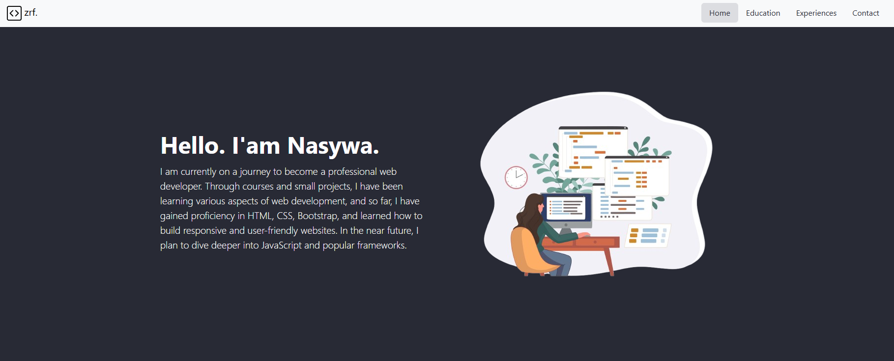
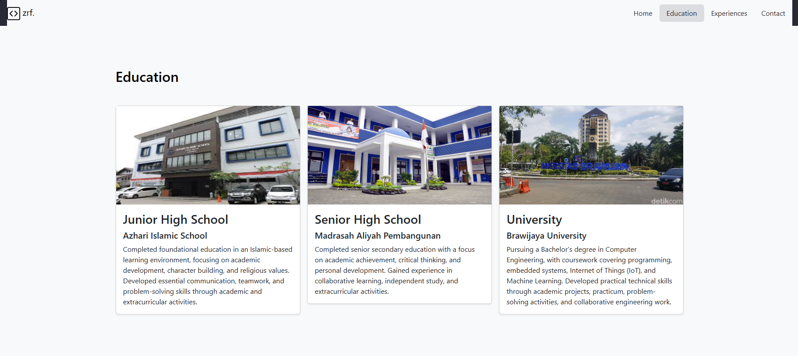
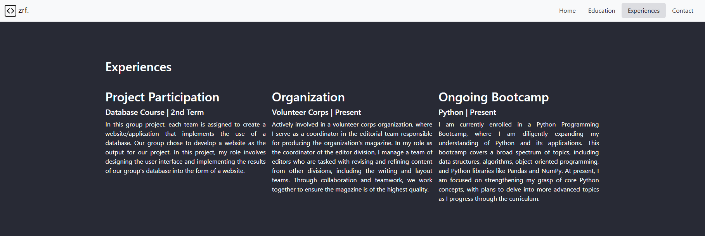

# Personal Website

A simple personal portfolio website built with HTML, CSS, and Bootstrap. It provides an overview of my educational background, experiences, and contact information through a clean and responsive web interface.

## Features

- **Introduction** — A brief introduction and personal background.
- **Education** — Display educational history with descriptions and images.
- **Experiences** — Showcase academic projects, organizational activities, and ongoing learning experiences.
- **Navigation** — Navigate between website sections using a Bootstrap navigation bar with smooth scrolling.
- **Responsive Layout** — Adapt the website layout to different screen sizes using Bootstrap.

## Tech Stack

- **Languages:** HTML5, CSS3
- **CSS Framework:** Bootstrap 5.3.3
- **JavaScript:** Bootstrap Bundle (for interactive components)

### Home Section

### Education Section

### Experiences Section

### Contact Section

## Project Background

This project was developed as a personal website to introduce myself and showcase my educational background and experiences. It also serves as a practical exercise in applying HTML, CSS, and Bootstrap to build a responsive website.

---

_Built as a personal web development project._
